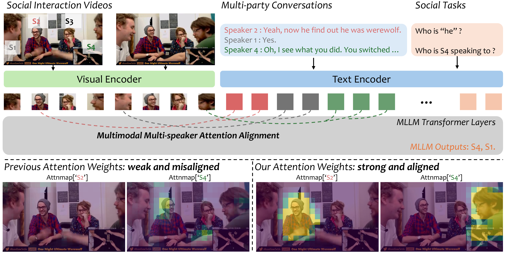

# Multi-speaker Attention Alignment for Multimodal Social Interaction

**Liangyang Ouyang**, Yifei Huang, Mingfang Zhang, Caixin Kang, Ryosuke Furuta, and Yoichi Sato

<p align="center">The University of Tokyo</p>

Our paper is accepted by **CVPR 2026**!

[[arXiv]](https://arxiv.org/abs/2511.17952) [[Paper]](paper/CVPR2026_MultiSpeakerAlignment.pdf) [[Supplementary]](paper/CVPR2026_MultiSpeakerAlignment_supp.pdf)

<p align="center">
  
</p>

## Release

- ✅ Paper
- ✅ Zero-shot code for Qwen2.5-VL and InternVL3 (`social_attention/`, `run_zeroshot.py`) with examples in
  `examples/`. The method is the single attention function
  [`social_aware_attention_forward`](social_attention/attention.py), plugged into HuggingFace `transformers`
  through its `AttentionInterface`; `models/` shows how to prepare the inputs for each MLLM.
- Training code: our original experiments were built on an old version of LLaMA-Factory. The attention function
  released here is the complete method (no extra parameters, applied in the forward pass), so it is sufficient
  to reproduce the training setting in any fine-tuning framework.
- Datasets: please obtain MMSI from [sangmin-git/MMSI](https://github.com/sangmin-git/MMSI) (OnlineMMSI:
  [Sampson-Lee/OnlineMMSI](https://github.com/Sampson-Lee/OnlineMMSI)) and TVQA+ from
  [jayleicn/TVQAplus](https://github.com/jayleicn/TVQAplus). `examples/samples.json` shows the input format
  (frames, transcript, speaker boxes, speaker spans); the clips in `examples/` are included for demonstration
  only.

## Abstract

Understanding social interaction in video requires reasoning over a dynamic interplay of verbal and non-verbal cues: who is speaking, to whom, and with what gaze or gestures. While Multimodal Large Language Models (MLLMs) are natural candidates, simply adding visual inputs yields surprisingly inconsistent gains on social tasks. Our quantitative analysis of cross-modal attention inside state-of-the-art MLLMs reveals a core failure mode: in multi-speaker scenes, visual and textual tokens lack speaker-consistent alignment, exhibiting substantially weaker cross-modal attention than in object-centric images. To address this, we propose a multimodal multi-speaker attention alignment method that can be integrated into existing MLLMs. First, we introduce dynamic cross-modal head selection to identify attention heads most responsible for grounding. Then, an adaptive social-aware attention bias, computed from existing attention patterns and speaker locations, is injected into the attention mechanism. This bias reinforces alignment between a speaker's visual representation and their utterances without introducing trainable parameters or architectural changes. We integrate our method into three distinct MLLMs (LLaVA-NeXT-Video, Qwen2.5-VL, and InternVL3) and evaluate on three benchmarks (TVQA+, MMSI, OnlineMMSI). Across four social tasks, results demonstrate that our approach improves the ability of MLLMs and achieves state-of-the-art results. Attention visualizations confirm our method successfully focuses the model on speaker-relevant regions, enabling more robust multi-party social reasoning.

## Usage

```bash
pip install -r requirements.txt   # torch>=2.6, transformers>=5.0 (tested with 5.4.0), pillow, numpy

python run_zeroshot.py --model qwen2_5_vl --data examples/samples.json --output outputs/qwen_ours.jsonl
python run_zeroshot.py --model qwen2_5_vl --data examples/samples.json --output outputs/qwen_base.jsonl --no-bias
python evaluate.py outputs/qwen_base.jsonl outputs/qwen_ours.jsonl
```

`--model internvl3` runs InternVL3-8B. `--alpha`, `--threshold`, `--layer-min/--layer-max` override the bias
hyper-parameters (defaults per model in `social_attention/models/`); `--head-stats` prints the ratio of active
heads, `--debug` prints the text covered by each speaker's spans.

Predictions of both models on the examples (`run_zeroshot.py`, greedy decoding, default settings):

| example | task | question | answer | Qwen2.5-VL | + ours | InternVL3 | + ours |
|---|---|---|---|---|---|---|---|
| `mmsi_009_0037_q355` | T | Predict the speaking target (speaking to whom) of this sentence: Speaker 3 : It doesn't matter because you're  | Speaker 4 | Speaker 0 ❌ | Speaker 4 ✅ | Speaker 4 ✅ | Speaker 4 ✅ |
| `mmsi_048_0069_q1647` | T | Predict the speaking target (speaking to whom) of this sentence: Speaker 4 : Who are you voting for? | Speaker 3 | Speaker 0 ❌ | Speaker 3 ✅ | Speaker 3 ✅ | Speaker 3 ✅ |
| `mmsi_136_0086_q631` | T | Predict the speaking target (speaking to whom) of this sentence: Speaker 3 : Because, they could both be werew | Speaker 2 | Speaker 0 ❌ | Speaker 0 ❌ | Speaker 0 ❌ | Speaker 2 ✅ |
| `mmsi_027_0125_q188` | N | Predict which speaker should be the [MASK] in this sentence: Speaker 5 : Them two, [MASK] and [Speaker 0]'s. | Speaker 1 | Speaker 2 ❌ | Speaker 1 ✅ | Speaker 1 ✅ | Speaker 1 ✅ |
| `mmsi_125_0080_q765` | N | Predict which speaker should be the [MASK] in this sentence: Speaker 0 : You want to kill [MASK]? | Speaker 3 | Speaker 3 ✅ | Speaker 3 ✅ | Speaker 1 ❌ | Speaker 3 ✅ |
| `mmsi_136_0092_q635` | P | Predict which speaker should be the [MASK] in this sentence: Speaker 1 : Oh yeah that's right. So then [MASK]  | Speaker 2 | Speaker 2 ✅ | Speaker 2 ✅ | Speaker 0 ❌ | Speaker 2 ✅ |
| `tvqa_01262_q1262` | QA | Where did Penny sit after taking water out of the fridge ? | a0 | a1 ❌ | a0 ✅ | a0 ✅ | a0 ✅ |
| `tvqa_00514_q514` | QA | What did Sheldon liken Leonard 's idea to when Leonard told his idea of the app ? | a0 | a0 ✅ | a0 ✅ | a1 ❌ | a0 ✅ |

## Citation

If this work is helpful in your research, please cite:

```bibtex
@article{ouyang2025multi,
  title={Multi-speaker Attention Alignment for Multimodal Social Interaction},
  author={Ouyang, Liangyang and Huang, Yifei and Zhang, Mingfang and Kang, Caixin and Furuta, Ryosuke and Sato, Yoichi},
  journal={arXiv preprint arXiv:2511.17952},
  year={2025}
}
```
